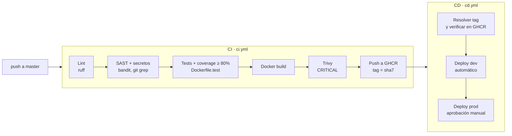
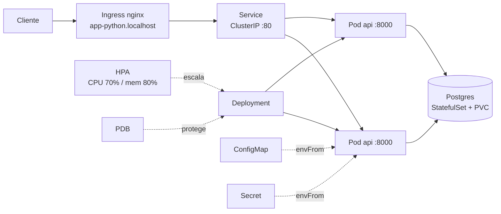

# devsu-danielboullon-devops

Ejercicio DevOps de Devsu con la app `demo-devops-python` (Django + DRF).
Dockerizada, con CI/CD en GitHub Actions y desplegada en Kubernetes con Kustomize.

## Dónde está cada cosa

| Qué | Dónde |
|---|---|
| App + Dockerfile | [app-python/](app-python/) |
| Tests en contenedor | [app-python/Dockerfile.test](app-python/Dockerfile.test) |
| CI | [.github/workflows/ci.yml](.github/workflows/ci.yml) |
| CD | [.github/workflows/cd.yml](.github/workflows/cd.yml) + [_deploy.yml](.github/workflows/_deploy.yml) |
| Manifiestos Kubernetes | [app-python-gitops/](app-python-gitops/) (simula un repo gitops aparte) |
| Cómo se opera (rollback, aprobaciones) | [app-python-gitops/README.md](app-python-gitops/README.md) |
| Cómo pensé cada decisión | [docs/razonamiento.md](docs/razonamiento.md) |
| Enunciado | [docs/enunciado.md](docs/enunciado.md) |
| Capturas | [docs/screenshots/](docs/screenshots/) |

## Cumplimiento

| Pide el enunciado | Estado | Evidencia |
|---|---|---|
| Dockerizar | ✅ | [Dockerfile](app-python/Dockerfile) · [razonamiento §1](docs/razonamiento.md#1-dockerizar-la-aplicación) |
| Build, tests, análisis estático, coverage | ✅ | [ci.yml](.github/workflows/ci.yml) · [corrida en verde](https://github.com/DrCoffee84/devsu-danielboullon-devops/actions/runs/44578179451) |
| Build & push de la imagen | ✅ | GHCR, tag = short SHA |
| Vulnerability scan (opcional) | ✅ | Trivy en el CI |
| Kubernetes con ≥ 2 réplicas y HPA | ✅ | [razonamiento §3](docs/razonamiento.md#3-kubernetes) |
| ConfigMap, Secret, Ingress | ✅ | [app-python-gitops/](app-python-gitops/) |
| Deploy a Kubernetes en el pipeline | 🟡 | [corrida del CD](https://github.com/DrCoffee84/devsu-danielboullon-devops/actions/runs/44813163928) · no aplica: ver [Lo que no hice](#lo-que-no-hice-y-por-qué) |
| URL pública | ❌ | Cluster local (el enunciado lo permite) |
| IaC en cloud (extra) | ❌ | Ver [Lo que no hice](#lo-que-no-hice-y-por-qué) |

## Diagramas

### Flujo CI/CD



### Despliegue en Kubernetes



En dev/prod Postgres es una base gestionada (ej: RDS), fuera del cluster.

## Docker

[app-python/Dockerfile](app-python/Dockerfile)

- Multi-stage → la imagen final no lleva herramientas de build.
- `requirements.txt` primero → aprovecha la caché de capas.
- `python:3.11-slim` → chica y compatible con las dependencias.
- gunicorn en el puerto 8000 → servidor de producción, no `runserver`.
- Usuario no-root (UID 10001) → si explotan la app, no es root.
- Código de solo lectura → el proceso no puede modificarse a sí mismo.
- `HEALTHCHECK` a `/healthz` → sirve fuera de Kubernetes (`docker run`).
- Sin migraciones al arrancar → son un paso del deploy, no de la imagen.

## Cambios en la app

Mínimos, solo para poder correrla en Kubernetes:

- Config por variables: `DJANGO_SECRET_KEY`, `DJANGO_DEBUG`, `DJANGO_ALLOWED_HOSTS`, `DATABASE_URL`.
- Sin `DATABASE_URL` sigue usando SQLite → no rompe el uso local ni los tests.
- `/healthz` → el proceso responde. No toca la base.
- `/readyz` → además hay conexión a la base (503 si no).
- Tests nuevos para los health checks. Coverage > 95%.

## Pipeline

### CI · [ci.yml](.github/workflows/ci.yml)

Corre en cada push a `master`.

| Paso | Herramienta | Por qué |
|---|---|---|
| Lint | ruff | errores de código antes de buildear |
| SAST | bandit | problemas de seguridad en el código |
| Secretos | `git grep` + chequeo de `.env` | que no se suba una clave |
| Tests + coverage | pytest en `Dockerfile.test`, mínimo 80% | mismas dependencias que la imagen |
| Build | `docker build` | |
| Vulnerability scan | Trivy, corta con CRITICAL | no publicar imágenes con CVE graves |
| Push | GHCR, tag = short SHA | tag inmutable y trazable al commit |

### CD · [cd.yml](.github/workflows/cd.yml) + [_deploy.yml](.github/workflows/_deploy.yml)

- 1 build → N deploys → a prod llega la misma imagen que se probó en dev.
- Arranca cuando el CI termina bien.
- dev automático → prod espera aprobación en el Environment `prod`.
- Solo tags SHA, nunca `latest` → se verifica que exista en GHCR.
- El tag se commitea en el overlay → Git dice qué corre en cada ambiente.
- Después: render → `kubectl apply` → `rollout status`.
- Rollback → relanzar el CD con el tag anterior.

Detalle de cómo se opera: [app-python-gitops/README.md](app-python-gitops/README.md).

## Kubernetes

Kustomize: una `base/` y un overlay por ambiente (`local`, `dev`, `prod`).

| Recurso | Para qué |
|---|---|
| Namespace | uno por ambiente (`app-python-<env>`), Pod Security `restricted` |
| Deployment | 2 réplicas, rolling update sin cortes, no-root, rootfs de solo lectura |
| initContainer `migrate` | corre las migraciones antes de cada pod |
| Probes | liveness `/healthz`, readiness `/readyz` |
| Service | ClusterIP, 80 → 8000 |
| HPA | escala por CPU y memoria (2–5 base, 3–10 prod) |
| PDB | deja pods vivos durante un drain |
| ConfigMap | `DJANGO_DEBUG`, `DJANGO_ALLOWED_HOSTS` |
| Secret | local: `secretGenerator` · dev/prod: ExternalSecret desde Vault |
| Ingress | nginx · TLS con cert-manager en dev/prod |
| NetworkPolicy | dev/prod: solo entra tráfico del Ingress |
| ServiceAccount | sin token montado |
| Postgres StatefulSet | solo en local, con PVC |

Decisiones clave:

- Liveness no mira la base → si cae la DB, no reinicia todos los pods.
- Namespace en el overlay, no en la base → cada ambiente es un namespace.
- Imagen pública → no hace falta `imagePullSecret`.

### Correrlo en local

Requisitos: Kubernetes de Docker Desktop, ingress-nginx y metrics-server.

```bash
kubectl apply -f app-python-gitops/overlays/local/namespace.yaml
kubectl apply -k app-python-gitops/overlays/local
kubectl get pods,hpa -n app-python-local
curl http://app-python.localhost/api/users/
```

Solo la imagen, sin Kubernetes:

```bash
cd app-python
docker build -t app-python .
docker run --rm -v app-data:/data -e DJANGO_SECRET_KEY=dev app-python python manage.py migrate
docker run --rm -p 8000:8000 -v app-data:/data -e DJANGO_SECRET_KEY=dev app-python
```

## Supuestos

- dev/prod tienen ingress-nginx, cert-manager y External Secrets con Vault instalados.
- La base de dev/prod es gestionada (ej: RDS). Su URL está en Vault.
- Los dominios `*.example.com` son de ejemplo.
- dev usa 1 réplica mínima para ahorrar. El mínimo de 2 lo cumplen local y prod.
- El cluster de cada ambiente se configura con el secret `KUBE_CONFIG` del Environment.

## Lo que no hice y por qué

- **Deploy real desde el pipeline**: mi cluster es local y GitHub Actions no llega. Sin `KUBE_CONFIG`, el CD commitea el tag, renderiza y sube el manifiesto como artifact, pero no aplica.
- **URL pública**: por lo mismo. El enunciado permite local.
- **IaC en cloud (extra)**: prioricé imagen, Kubernetes y pipeline, no tengo una cuenta de aws disponible y el tiempo era limitado. 

## Para producción

- DNS y TLS: dominio real + cert-manager con Let's Encrypt (ya está en los Ingress).
- Acceso del CD: OIDC y un ServiceAccount acotado al namespace, no un kubeconfig admin.
- GitOps: Argo CD con sync disparado por el pipeline (sin auto-sync).
- Migraciones: un Job antes del rollout en lugar del initContainer.
- Observabilidad: métricas, logs centralizados y alertas sobre 5xx y `/readyz`.
- Backups: los da la base gestionada.
