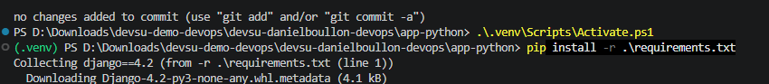

# Objectivo 

No es un documento formal sino que acá voy a ir escribiendo cómo pienso y encaro el ejercicio. 

Como me están evaluando, voy a explicar paso a paso mi razonamiento y las decisiones que voy tomando para resolver el ejercicio. La no es utilizar IA para que resuelva todo por mí, sino como una herramienta de apoyo para tareas que manualmente serían más pesadas. No es algo demasiado complejo, sino más bien un escenario típico de DevOps, así que mi objetivo es demostrar principalmente cómo abordo los problemas, cómo los analizo, cómo llego a las soluciones y el porqué de ellas.

> nota: revise la app con IA y mano al ser un zip externo, verifique que no tenga scrits escondidos (como en el .git), ni hooks ni dependencias raras, que compromentan mi PC. 

## Enunciado

Deje una copia del enunciado en [docs\enunciado.md](enunciado.md) para tener a mano e ir cumpliendo punto por punto, el primero es dockerizar la app, yo elegi la de ´devsu-demo-devops-python´. 

### Dockerizar la aplicación

Lo primero que voy a hacer es leer la app, ver sus endpoints y configuraciones. La app 

#### Stack
- Django 4.2 + DRF 3.14 + django-environ 0.10. Python 3.11.3.
- Base de datos: SQLite (db.sqlite3, es un archivo local).
- Entrypoints: demo/wsgi.py y demo/asgi.py. No hay servidor de producción en requirements.txt: no está gunicorn ni uvicorn.

#### Notas Devops
- No tiene Healthcheks ni readiness -> se la voy a agregar  
- El Post de users devuelve 201 no 200 -> voy a cambiar la docu
- Es mala practica dejar el .env con claves (por mas que sean locales) -> en su lugar voy a cambiarlo por el .env.example con la lista de variables vacias. (normalmente se rotarian porque ya quedo en el historial) ```git rm --cached app-python/.env```
- Voy a correr la app en local para ver como funciona, usando venv

- Corre bien la app localmente, segun el readme hay que haer migraciones a la DB y demas, esto no lo voy a poner en el Dockerfile ya que la app no se deberia encargar de esto, tampoco voy a cambiar como arranca la app ya que no es el foco del ejercicio,  
- Voy a dockerizarla tal cual como esta solo agregando lo necesario para que se pueda desplegar bien en Kubernetes productivo (usando ), para eso ya es mas practico usar la IA, yo hice este promt rapido:

```text
Generame únicamente el Dockerfile dentro de app-python/ usando multi-stage y buenas prácticas. Si hace falta sumar o cambiar algo en el .env, avisame qué es y lo ajusto yo, pero vos asumí que ya está listo. Quiero que quede un Dockerfile final bien sólido: copiando primero el requirements.txt para aprovechar la caché de capas, exponiendo los puertos que correspondan, usando un stage con herramientas de build/instalación y pasando a una imagen slim corriendo con usuario no-root para ejecución, además de todo lo que sume en seguridad y rendimiento.```

- Build de docker 

- La app funciona bien en local , tiene la db dentro del conectedor pero la saquere para hacerla via AWS (o un pod en k8s por el labotario)

