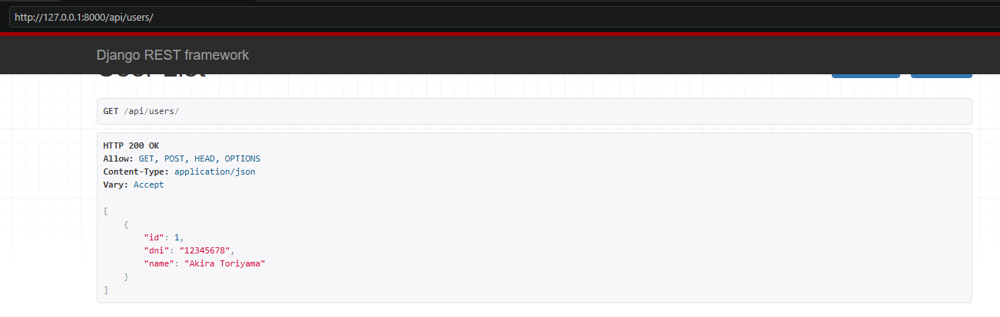

# Objectivo 

No es un documento formal sino que acá voy a ir escribiendo cómo pienso y encaro el ejercicio. 

Como me están evaluando, voy a explicar paso a paso mi razonamiento y las decisiones que voy tomando para resolver el ejercicio. La no es utilizar IA para que resuelva todo por mí, sino como una herramienta de apoyo para tareas que manualmente serían más pesadas. No es algo demasiado complejo, sino más bien un escenario típico de DevOps, así que mi objetivo es demostrar principalmente cómo abordo los problemas, cómo los analizo, cómo llego a las soluciones y el porqué de ellas.

> nota: revise la app con IA y mano al ser un zip externo, verifique que no tenga scrits escondidos (como en el .git), ni hooks ni dependencias raras, que compromentan mi PC. 

## Enunciado

Deje una copia del enunciado en [docs\enunciado.md](enunciado.md) para tener a mano e ir cumpliendo punto por punto, el primero es dockerizar la app, yo elegi la de ´devsu-demo-devops-python´. 

### Dockerizar la aplicación

Lo primero que voy a hacer es leer la app, ver sus endpoints y configuraciones. La app 

#### Stack
- Django 4.2 + DRF 3.14 + django-environ 0.10. Python 3.11.3.
- Base de datos: SQLite (db.sqlite3, es un archivo local).
- Entrypoints: demo/wsgi.py y demo/asgi.py. No hay servidor de producción en requirements.txt: no está gunicorn ni uvicorn.

#### Notas Devops
- No tiene Healthcheks ni readiness -> se la voy a agregar  
- El Post de users devuelve 201 no 200 -> voy a cambiar la docu
- Es mala practica dejar el .env con claves (por mas que sean locales) -> en su lugar voy a cambiarlo por el .env.example con la lista de variables vacias. (normalmente se rotarian porque ya quedo en el historial) ```git rm --cached app-python/.env```
- Voy a correr la app en local para ver como funciona, usando venv

- Corre bien la app localmente, segun el readme hay que haer migraciones a la DB y demas, esto no lo voy a poner en el Dockerfile ya que la app no se deberia encargar de esto, tampoco voy a cambiar como arranca la app ya que no es el foco del ejercicio,  

#### Dockerizar la app
- Voy a dockerizarla tal cual como esta solo agregando lo necesario para que se pueda desplegar bien en Kubernetes productivo (usando ), para eso ya es mas practico usar la IA, yo hice este promt rapido:

```text
Generame únicamente el Dockerfile dentro de app-python/ usando multi-stage y buenas prácticas. Si hace falta sumar o cambiar algo en el .env, avisame qué es y lo ajusto yo, pero vos asumí que ya está listo. Quiero que quede un Dockerfile final bien sólido: copiando primero el requirements.txt para aprovechar la caché de capas, exponiendo los puertos que correspondan, usando un stage con herramientas de build/instalación y pasando a una imagen slim corriendo con usuario no-root para ejecución, además de todo lo que sume en seguridad y rendimiento.```

- Build de docker 

- Me fallo el Dockerfile run porque el usuario no tenia permisos de lectura para la base de datos, lo cambio... 

- La app funciona bien en local , tiene la db dentro del conectedor pero la saquere (CUando llegue a la parte de k8s) para hacerla via AWS (o un pod en k8s por el labotario)

#### Pipeline

Voy a empezar con la parte de pipelines, para eso creamos dos pipeline de CI/CD 
Uno que sea CI con los pasos mencionados en en el enunciado, o sea hasta el build&push 
Y luego hare el CD que haga el deploy en K8s con tags (para este ejercicio se me hace lo mas simple, pero se podria usar cualquier branching strategy)

Empiezo con el CI: 
- A mi me gusta (esto igual es discutible) meter los test en un archivo nuevo llamado Dockerfile.test, esto hace que el pipeline sea mas generico y no dependa ya del lenguaje.

- Una vez generado el Dockerfile.test voy a emepzar con el CI propiamente dicho, voy a usar githubActions (asi pueden ver las corridas que fui haciendo) y usare todas herramientas locales para que funcione, la idea es monstar una implemntacion minima, pero funcional.

- Corregi un error del pipeline ya que la ia uso la rama Main en vez de master (la que tenia en mi local)

- Corri el pipeline y fallo en el lint, pero fallo bien, ya que ruff encontro errores de lint, voy arreglarlos ya que estamos!
https://github.com/DrCoffee84/devsu-danielboullon-devops/actions/runs/44568310550/job/135716069482 

- Hice los tres cambios y ruff ya pasa en local. 

- volvio a fallar el pipeline pero ahora por temas de seguridad trivy detecto fallas en las dependencias de Python, detalles: https://github.com/DrCoffee84/devsu-danielboullon-devops/actions/runs/44570413788/job/135723593993


- Listo se corrigio los errores de trivy , ahora la imagen es segura (mas segura que antes), se podria poner mas escaneres, o jugar un poco mas , pero creo que el punto esta bien. https://github.com/DrCoffee84/devsu-danielboullon-devops/actions/runs/44578179451

- Siguietne paso: Una vez que tengo mi imagen en mi repositorio (GitHub Container Registry)

Considero que la parte de CI ya esta y voy a pasar a la parte de CD

pero tengo varios probelmas

1. No un lugar donde desplegar, entonces voy a crear un laboratio local de k8s
2. Para eso voy a usar docker desktop, ya que mi pc es windows y con un nodo para 2 pods me alcanza y sobra 
3. SI uso k8s, debo definir tambien como voy de deployar esto, en la caprtea de la app, teoricamente es del dev, salvo ayudarlo con los Dockerfile (via PR o dejando una plantilla decente como punto de partida) no me gustaria tocar su repositorio, entonces voy a crear una carpeta de gitops simulando un repositorio extra (en esta practica dejo todo en unlugar para uqe sea mas facil evalular) donde estaran los archivos necesraios para hacer el deploy en kubernetes 

Para crear estas caperta me gusta tener una nomenclatura que sea $nombreDeApp-gitops, esto se puede crear apartir de IDP de la empresa. 

Como la imagen esta publica voy a crear el deploymente con la imagen publica.

Use la ia para crear los archivos de kuztomice base y overlay, pero no me gusto que haya puesto el namespace en base, ya uqe me gusta considerar cada overlay como una ambiente y cada ambiente en k8s me gustar representarlos con un post fijo en el namespace de la app, quizas luego instancie la DB fuera de del namespace.  Esto lo peude hacer tranquilamente el IDP de forma automatica

aplicio el kubectl kustomize overlays/local

pero para mi es buena practica primero crear el namespace, siento que es meno propenso a erroes

$kubectl apply -f app-python-gitops/overlays/local/namespace.yaml
namespace/app-python-local created

$ kubectl apply -k app-python-gitops/overlays/local
namespace/app-python-local configured
serviceaccount/app-python created
configmap/app-python-config-g889mfd7gk created
secret/app-python-secret-85f6f6mfgc created
service/app-python created
deployment.apps/app-python created
poddisruptionbudget.policy/app-python created
horizontalpodautoscaler.autoscaling/app-python created
ingress.networking.k8s.io/app-python created


veo que los pods corren bien 
$ kubectl get pods -n app-python-local
NAME                          READY   STATUS    RESTARTS   AGE
app-python-69b46b558f-c9fbc   1/1     Running   0          69s
app-python-69b46b558f-df2hw   1/1     Running   0          69s

Y el servicio responde bien en local:
$  curl.exe http://app-python.localhost/api/users/1/ -v
*   Trying 127.0.0.1:80...
* Connected to app-python.localhost (127.0.0.1) port 80 (#0)
> GET /api/users/1/ HTTP/1.1
> Host: app-python.localhost
> User-Agent: curl/8.0.1
> Accept: */*
> 
< HTTP/1.1 200 OK
< Date: Thu, 19 Nov 2026 18:23:22 GMT
< Content-Type: application/json
< Content-Length: 49
< Connection: keep-alive
< Vary: Accept, Cookie
< Allow: GET, PUT, PATCH, DELETE, HEAD, OPTIONS
< X-Frame-Options: DENY
< X-Content-Type-Options: nosniff
< Referrer-Policy: same-origin
< Cross-Origin-Opener-Policy: same-origin
< 
{"id":1,"dni":"12341234","name":"Akira Toriyama"}* Connection #0 to host app-python.localhost left intact