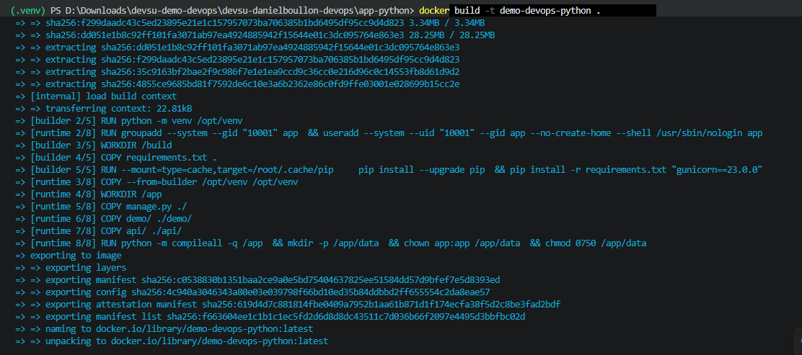
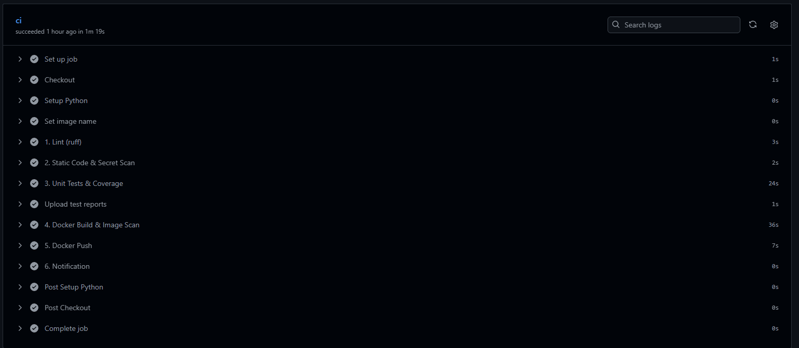
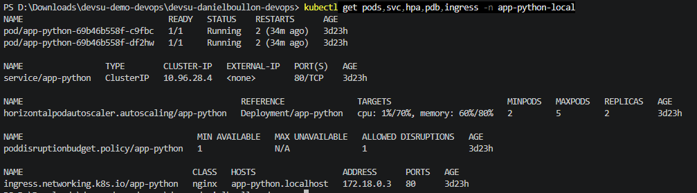
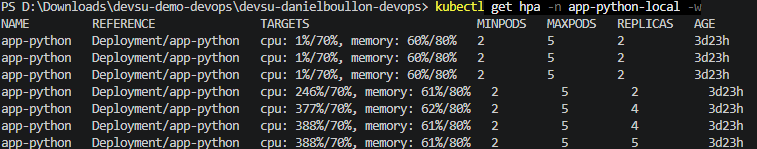
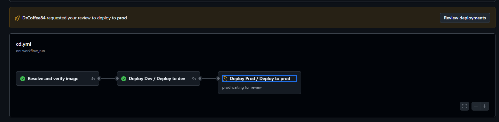
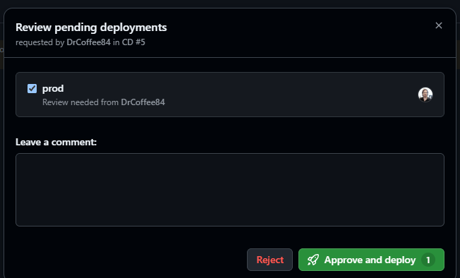

# Razonamiento

No es un documento formal: acá voy anotando cómo pienso y encaro el ejercicio.

Como me están evaluando, quiero que se vea el porqué de cada decisión. La idea no es que la IA resuelva todo por mí, sino usarla como apoyo en las tareas que a mano serían más pesadas. El escenario es un caso típico de DevOps, así que lo importante es mostrar cómo analizo el problema y cómo llego a cada solución.

> Nota: como la app vino en un zip externo, la revisé a mano y con IA antes de correr nada. Verifiqué que no tuviera scripts escondidos (por ejemplo en `.git`), hooks ni dependencias raras que comprometan mi PC.

## Enunciado

- Dejé una copia en [enunciado.md](enunciado.md) para tenerlo a mano e ir cumpliendo punto por punto.
- Elegí la app de Python (`demo-devops-python`).

## 1. Dockerizar la aplicación

Lo primero es leer la app: endpoints, configuración y cómo arranca.

### Stack

- Django 4.2 + DRF 3.14 + django-environ 0.10, Python 3.11.3.
- Base de datos SQLite (`db.sqlite3`, archivo local).
- Entrypoints `demo/wsgi.py` y `demo/asgi.py`. No hay servidor de producción en `requirements.txt` (ni gunicorn ni uvicorn).

### Lo que veo como DevOps

- No tiene healthcheck ni readiness → se los quiero agregar.
- El POST de users devuelve 201, no 200 → corrijo la docu.
- Dejar el `.env` con claves es mala práctica, aunque sean locales → lo saco y dejo un `.env.example` con las variables vacías. En un caso real además las rotaría, porque ya quedaron en el historial.
  ```
  git rm --cached app-python/.env
  ```
- Corro la app en local con venv para ver cómo funciona:
  
- Funciona bien. Según el README hay que correr las migraciones; eso no debería ser responsabilidad de la imagen, y tampoco quiero cambiar cómo arranca la app porque no es el foco del ejercicio.
  

### Dockerfile

- La dockerizo tal cual está, agregando solo lo necesario para que se pueda desplegar bien en un Kubernetes productivo.
- Acá sí es más práctico usar la IA. Le pasé este prompt:

  ```text
  Generame únicamente el Dockerfile dentro de app-python/ usando multi-stage y buenas prácticas. Si hace falta sumar o cambiar algo en el .env, avisame qué es y lo ajusto yo, pero vos asumí que ya está listo. Quiero que quede un Dockerfile final bien sólido: copiando primero el requirements.txt para aprovechar la caché de capas, exponiendo los puertos que correspondan, usando un stage con herramientas de build/instalación y pasando a una imagen slim corriendo con usuario no-root para ejecución, además de todo lo que sume en seguridad y rendimiento.
  ```

- Build:
  
- El primer `docker run` falló: el usuario no-root no tenía permisos sobre la base de datos. Lo corregí.
- Ahora funciona en local. La base queda dentro del contenedor; la voy a sacar cuando llegue a Kubernetes (en AWS, o un pod en el laboratorio).

## 2. Pipeline

Separo en dos pipelines:

- **CI**: los pasos del enunciado, hasta el build & push.
- **CD**: el deploy a Kubernetes.

### CI

- Me gusta (es discutible) poner los tests en un `Dockerfile.test`. Corren con las mismas dependencias que la imagen y el paso del pipeline queda igual para cualquier lenguaje. El lint y el SAST quedaron en el runner porque ahí son más rápidos.
- Uso GitHub Actions, así se pueden ver las corridas que fui haciendo. La idea es una implementación mínima pero funcional, con herramientas que corran dentro del runner.
- La IA había puesto la rama `main` y yo trabajo en `master` → lo corregí.
- Primera corrida: falló en el lint, pero falló bien. Ruff encontró errores reales y ya que estamos los arreglé.
  https://github.com/DrCoffee84/devsu-danielboullon-devops/actions/runs/44568310550/job/135716069482
- Hice los tres cambios y ruff pasó en local.
- Segunda corrida: falló por seguridad. Trivy detectó CVE críticos en las dependencias de Python.
  https://github.com/DrCoffee84/devsu-danielboullon-devops/actions/runs/44570413788/job/135723593993
- Subí Django a 4.2.30 y Trivy pasó. La imagen queda más segura que antes. Se podrían sumar más escáneres, pero para el ejercicio me parece suficiente.
  https://github.com/DrCoffee84/devsu-danielboullon-devops/actions/runs/44578179451
- Con la imagen ya publicada en GitHub Container Registry, doy el CI por terminado.



## 3. Kubernetes

Antes del CD tengo algunos problemas que resolver:

1. No tengo dónde desplegar → armo un laboratorio local de Kubernetes.
2. Uso Docker Desktop porque estoy en Windows, y un nodo para 2 pods me alcanza y sobra.
3. Tengo que definir dónde viven los manifiestos. La carpeta de la app, en teoría, es del dev; salvo ayudarlo con los Dockerfile (por PR o dejando una plantilla decente), no quiero tocar su repo. Entonces creo una carpeta gitops que simula un repositorio aparte. Acá queda todo junto para que sea más fácil de evaluar.

Decisiones:

- Nomenclatura `<nombreDeApp>-gitops`. En una empresa esto lo podría crear el IDP.
- Como la imagen es pública, el Deployment la usa directo, sin `imagePullSecret`.
- Usé la IA para armar Kustomize con base y overlays. No me gustó que pusiera el namespace en la base: para mí cada overlay es un ambiente, y cada ambiente es un namespace con el ambiente como sufijo (`app-python-local`, `app-python-dev`, `app-python-prod`). Esto también lo podría automatizar el IDP. Más adelante quizás saque la DB a otro namespace.
- Reviso el render con `kubectl kustomize overlays/local`.
- Prefiero crear primero el namespace; me parece menos propenso a errores:

```
$ kubectl apply -f app-python-gitops/overlays/local/namespace.yaml
namespace/app-python-local created

$ kubectl apply -k app-python-gitops/overlays/local
namespace/app-python-local configured
serviceaccount/app-python created
configmap/app-python-config-g889mfd7gk created
secret/app-python-secret-85f6f6mfgc created
service/app-python created
deployment.apps/app-python created
poddisruptionbudget.policy/app-python created
horizontalpodautoscaler.autoscaling/app-python created
ingress.networking.k8s.io/app-python created
```

Los pods corren bien:

```
$ kubectl get pods -n app-python-local
NAME                          READY   STATUS    RESTARTS   AGE
app-python-69b46b558f-c9fbc   1/1     Running   0          69s
app-python-69b46b558f-df2hw   1/1     Running   0          69s
```

Y el servicio responde por el Ingress:

```
$ curl.exe http://app-python.localhost/api/users/1/
HTTP/1.1 200 OK
{"id":1,"dni":"12341234","name":"Akira Toriyama"}
```




### Probe HPA




Estaba probando el  HPA y vi que no bajaba automaticamente, al poner gunicorn y la configuraciones del hpa en memory 80%, y  al ser una app simple y tener tan poca ram asignada, nunca bajaba de 5 porque el promedio de ram me daba 66% en 5 pods y hpa hace las cuentas y dice "si bajo a 4 me queda por arriba del 80% entonces no bajo"

Si fuera producion real se haria un estudio de la app , memoria promedio y tope, resources y limits, pero como es un ejercicio simplemetne quito la ram del HPA y lo comiteo.


## 4. CD

- Siempre pienso en **1 build → N deploys**: la imagen se construye una sola vez y se promueve la misma a cada ambiente.
- Uso la rama principal para desplegar a dev y a prod.
- ¿Por qué? Porque con los aprobadores de los Environments de GitHub solo llega a prod lo que ya se probó en otro ambiente (dev; también podrían ser test y stage). En lo que vi, cada vez más equipos usan 2 ambientes en vez de 4, y algunos ya prueban directo en producción.
- Cómo quedó el flujo final, con el tag commiteado en Git: ver [Sigo, hoy es otro día](#sigo-hoy-es-otro-día-cierro-el-cd-con-gitops).

## 5. Pendientes

Con todo andando, repasé lo que me fui anotando en el camino y lo que dejé "para después". Algunas cosas las fui parchando para avanzar y ahora las cierro bien.

### Lo que resolví

- **Healthchecks**: había dicho que los iba a agregar y las probes seguían pegándole a `/api/users/`, que consulta la base. Si se cae la DB, Kubernetes reiniciaría todos los pods sin motivo. Agregué dos endpoints:
  - `/healthz` para liveness: solo dice que el proceso responde.
  - `/readyz` para readiness: además chequea la base; si falla, el pod sale del Service pero no se reinicia.
  - Los puse en un middleware al principio de la cadena para que respondan sin validar el Host, porque el kubelet llega con la IP del pod.
- **DEBUG y ALLOWED_HOSTS**: estaban fijos en el código (`DEBUG=True`, `ALLOWED_HOSTS=[]`) y lo había parchado forzando `Host: localhost` en probes e Ingress. No me gustaba. Ahora salen de variables de entorno (`DJANGO_DEBUG`, `DJANGO_ALLOWED_HOSTS`), cada overlay pone su dominio en el ConfigMap y saqué el parche.
- **Base de datos**: SQLite en un `emptyDir` significa que cada pod tiene su propia base. Con 2 réplicas, creás un usuario en un pod y el otro no lo ve. Lo cambié a Postgres:
  - La app lee `DATABASE_URL`; si no está, sigue usando SQLite (así no rompo el uso local ni los tests).
  - En local agregué un StatefulSet de Postgres con su volumen.
  - En dev/prod la URL viene de Vault, pensando en una base gestionada (RDS).
  - Toqué lo mínimo del código de la app: settings y un middleware.
- **Migraciones**: había dicho que no las quería en el Dockerfile y al final la imagen corría `migrate` al arrancar. Lo saqué del `CMD` y ahora las corre un initContainer antes de cada pod. Con `maxSurge: 1` en un rollout migra un pod a la vez. En el primer deploy pueden chocar dos pods, pero el initContainer se reinicia y sigue; para algo más serio lo pasaría a un Job o a un paso del CD.
- **Tests**: agregué tests para los health checks y para que un Host desconocido se rechace. La cobertura quedó arriba del 95%.

### Lo que dejo pendiente

- **IaC (punto extra)**: no lo hice. Prioricé que la imagen, Kubernetes y el pipeline quedaran bien.
- **Deploy desde el pipeline**: el CD está armado, pero GitHub Actions no llega a mi cluster local. Sin `KUBE_CONFIG` renderiza y valida, pero no aplica.
- **DNS y TLS reales**: los Ingress de dev/prod usan `*.example.com`. Con un dominio real, cert-manager y Let's Encrypt ya están preparados.
- **Permisos del CD**: hoy usaría el kubeconfig que le pase. Lo correcto es un ServiceAccount con permisos acotados a su namespace.
- **GitOps de verdad**: armé la carpeta como si fuera un repo gitops, pero el que aplica es el pipeline. El paso siguiente sería Argo CD o Flux.
- **Backups de la base**: en local no hay; en prod los daría la base gestionada.


### Sigo, hoy es otro día: cierro el CD con GitOps

Probé el pipeline de CD de punta a punta. El apply está mockeado porque no tengo un cluster de k8s vivo al que GitHub Actions pueda llegar, pero el flujo es el real: https://github.com/DrCoffee84/devsu-danielboullon-devops/actions/runs/44813163928

Revisando el diseño me di cuenta de que había algo mal: dev y prod no seguían el mismo criterio. El tag se cambiaba en el runner con `kustomize edit set image` y se aplicaba sin commitear, así que lo desplegado vivía solo en memoria del job y el repo no decía qué versión corría en cada ambiente. Lo cambié para que haya un único flujo GitOps para los dos:

- `cd.yml` resuelve el tag (short SHA), verifica que la imagen exista en GHCR y llama a `_deploy.yml` una vez por ambiente: dev automático y prod después de dev, con la aprobación del Environment.
- `_deploy.yml` hace lo mismo en dev y en prod: checkout de `master`, `kustomize edit set image` en `overlays/<env>`, commit `chore(<env>): set image tag <sha> [skip ci]`, `git pull --rebase` y push a `master`. Recién después renderiza con `kustomize build`, sube el manifiesto como artifact y, si el Environment tiene `KUBE_CONFIG`, aplica y espera el `rollout status`.

¿Por qué commitear en los dos ambientes? Porque así **Git es la única fuente de verdad**: el `newTag` de cada `kustomization.yaml` es exactamente lo que está desplegado, el historial de `master` es el historial de deploys y un rollback es volver a un commit (o relanzar el CD con un tag anterior). El `[skip ci]` es un seguro: hoy no haría falta, porque GitHub no dispara workflows con los push del `GITHUB_TOKEN` (justamente para evitar loops). Pero si mañana el commit lo hace una GitHub App o un token propio, por ejemplo con el repo gitops aparte, sin eso el commit del CD dispararía el CI y el CI otra vez el CD. El `pull --rebase` antes del push es para que el commit de prod no choque con el de dev, que se pushea unos minutos antes.

Los permisos los dejé al mínimo: `permissions: {}` global en `cd.yml`, `packages: read` solo para el job que consulta GHCR y `contents: write` explícito en los jobs que llaman al reusable. Un workflow reusable no puede pedir más permisos de los que le da quien lo llama; sin ese `contents: write` en el caller, GitHub corta el run con un `Startup failure` antes de arrancar.

El paso siguiente sería sumar Argo CD. No me gusta el `auto-sync`: por experiencia trae sorpresas (syncs en momentos que nadie eligió, drift que se pisa sin que nadie lo mire). Prefiero que el deploy sea algo controlado. Con este diseño el cambio es chico: el pipeline sigue commiteando el tag igual que ahora y, en lugar del `kubectl apply`, dispara por CLI el sync contra ese commit, algo como `argocd app sync app-python-<env> --revision <sha-del-commit>` seguido de `argocd app wait app-python-<env> --health --timeout 300`. Argo CD lee el estado de Git, el pipeline solo decide cuándo, y queda registrado quién y qué se desplegó.




https://github.com/DrCoffee84/devsu-danielboullon-devops/actions/runs/45216921482/job/137840646424
